# Unslop audit virtuse.com (staging, 16. 11. 2026)

Fáza 1: len audit. Nič som neupravil, nič som necommitol a nič som nenasadil.

## Ako som postupoval

- Nástroj: pravidlá skillu unslop od Damira Sokolovského (github.com/heydamir/unslop, CC BY 4.0), konkrétne `SKILL.md` a `references/signs.md`. Plugin som cez `claude plugin install` nenainštaloval, lebo príkaz `claude` na tomto Macu nie je v PATH a nainštalovaný plugin by aj tak fungoval až v novej session. Pravidlá som si prečítal priamo z repozitára a použil ich ručne. Do repozitára som nič nepridal, `.claude/settings.json` je bez zmeny.
- Smer: vlastný dizajn Virtuse, nie nový smer z unslopu. Tokeny z `site-v2.css` (`--dark #08090a`, `--card #141414`, `--text #e6edf3`, `--muted #8b949e`, oranžová `#f7931a` ako jediná výrazná farba v hube, kategóriové farby `acc-*`, Inter a JetBrains Mono) a pre Brief jeho vlastný redakčný vzhľad (IBM Plex Mono a Source Serif 4). Za chybu považujem iba nekonzistentnosť v rámci tohto systému a jasné znaky „AI vzhľadu“. Čo by menilo identitu, je v časti Voliteľné nápady.
- Staging beží na `main` (Brief portál z PR #177 je už v `main`) plus vetva `seo/retirement-questions-2026-11-16` pre dôchodkovú kalkulačku. Fáza 2 by teda išla oproti `main`, nie oproti `feat/brief-portal`.
- Snímky: headless Chromium, 1440 px a 390 px, celá stránka po prejdení až na koniec (aby sa načítali sekcie, ktoré sa zobrazujú až pri scrollovaní), cookie lišta odmietnutá. K tomu som z prehliadača vytiahol vypočítané štýly (písma, hrúbky, farby, prechody, tiene, animácie, hodnoty mimo 4 px mriežky).
- Verdict: výsledok Lite (obrazovka 8), obrazovku s výberom Lite alebo 14 € (obrazovka 7) a ukážku plného reportu (obrazovka 9) som otvoril tak, že som do `sessionStorage` vložil hotové odpovede fiktívnej Anny. Všetky požiadavky okrem GET som blokoval, takže sa neodoslal žiadny e‑mail ani platba.
- Horizontálne pretečenie: na všetkých 18 snímkach 0 px.
- Výrezy sú v priečinku `audits/unslop-2026-11-16/`.

Závažnosť: **vysoká** = vidí to každý návštevník alebo to brzdí hlavnú akciu, **stredná** = viditeľná nekonzistentnosť alebo znak AI vzhľadu, **nízka** = detail.

---

## 1. Homepage `/` a `/sk/`

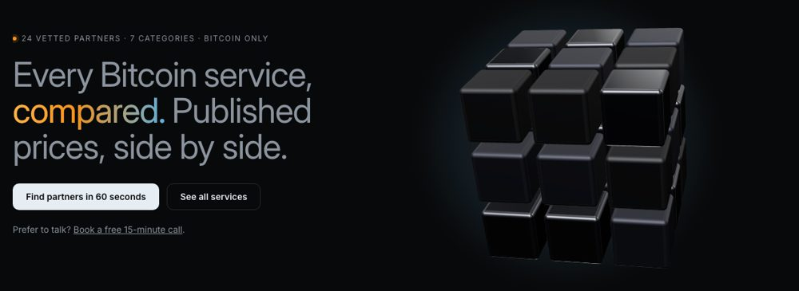

| # | Čo | Kde | Závažnosť | Návrh |
|---|---|---|---|---|
| H1 | Panel „Buy Bitcoin“ je celý zafarbený do hnedooranžova (radiálny prechod 0,30 plus lineárny `#1a1006 → #3a1f08`). Je to jediná plocha v hube, ktorá nie je neutrálna. | `index.html` a `site-v2.css`, `.feature .panel.spot` | stredná | Rovnaká plocha `--card` ako ostatné panely, oranžová len ako jemná žiara v rohu (0,10), rovnako ako pri `acc-*`. |
| H2 | Suma „€480“ má okolo seba oranžovú žiaru (`text-shadow 0 0 30px`). | `index.html:857`, `#diff10` / `.diff .diff-big` | stredná | Žiaru zrušiť, oranžovú farbu čísla nechať. |
| H3 | V ukážke Verdictu je tlačidlo „Get your free Lite score“ modré a pod kartou je modrý tieň. Na jednej obrazovke sú tak tri farby tlačidiel: oranžová v navigácii, svetlá v hero a modrá tu. | `index.html`, `#verdict a`, `#mlDemo` | stredná | Tlačidlo v štýle sekundárneho (svetlé alebo obrysové), modrý tieň nahradiť neutrálnym. |
| H4 | Obrázok Obr. 0.2 má modrú skenovaciu čiaru a pulzujúce body (nekonečné animácie `cubeScan` 2,2 s, `cubeNode` 1,8 s). Vedľajšie obrázky 0.1 a 0.3 sú neutrálne a statické. | `index.html:391`, `.cube-scan`, `.cube-node` | nízka | Zastaviť pohyb a dať rovnakú neutrálnu farbu ako ostatné dva obrázky. |
| H5 | V „How Virtuse works“ je štítok „Step 01“ až pod textom a krok 3 má pod sebou dva odkazy. | `index.html:686`, `.how-log-num`, krok 3 | nízka | Štítok nad nadpis, v kroku 3 nechať jeden odkaz (druhý ako obyčajný text). |
| H6 | Na kartách služieb je medzi nadpisom a popisom asi 140 px prázdneho miesta. Na desktope pôsobia karty prázdne. | `.shelf6 a` (`min-height` a `space-between`) | nízka | Znížiť `min-height` alebo dať fakt pod nadpis. Ide o vedomé rozhodnutie zo septembra, takže len ak sa ti to nepáči. |
| H7 | SK: „Spravte si audit **vášho** Bitcoin plánu“. Na `sk/verdict.html` je správne „svojho“. | `sk/index.html` (zdroj `i18n-tools/home/sk.json`) | nízka | Zmeniť na „svojho“. Význam sa nemení. |
| H8 | Hodnoty mimo 4 px mriežky: `padding-top: 13px` osemkrát, `gap: 5px`, `padding-top: 9px`. | viacero miest, spoločne so `site-v2.css` | nízka | Zaokrúhliť na 12, 4 a 8. |

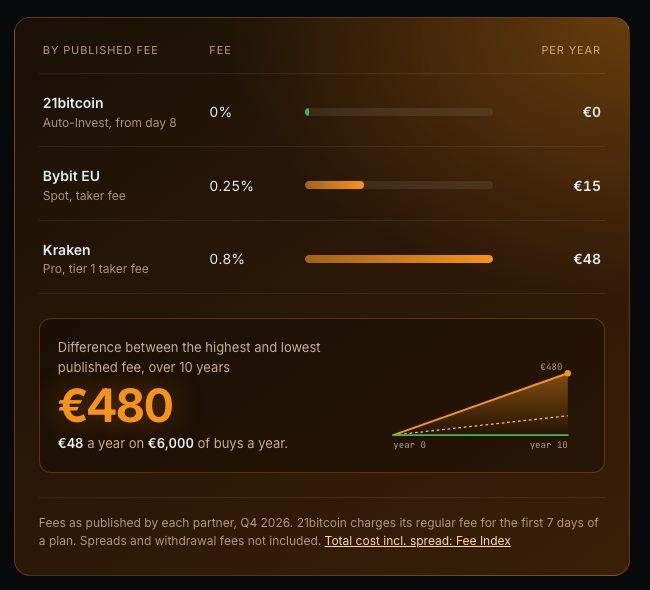
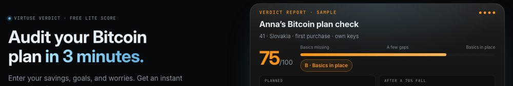
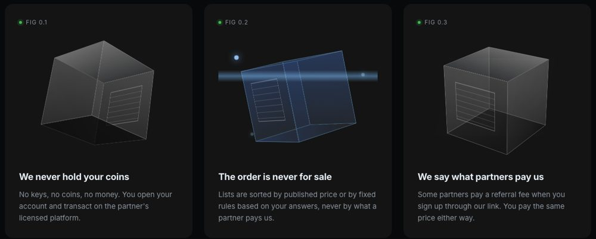
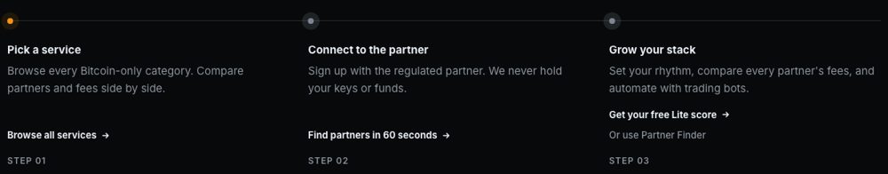
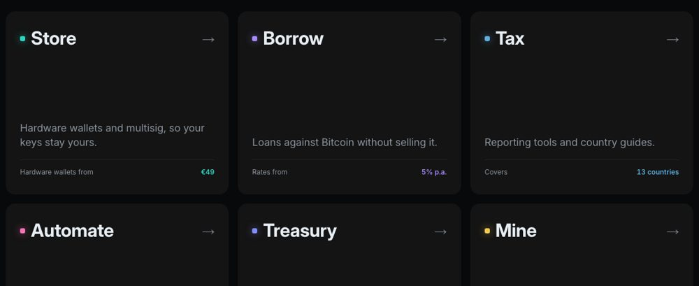

---

## 2. Verdict `/verdict.html` a `/sk/verdict.html`

### Úvodná stránka

| # | Čo | Kde | Závažnosť | Návrh |
|---|---|---|---|---|
| V1 | Čísla 5, 6 a 13 v sekcii „Built for beginners“ majú text vyplnený prechodom. Prechod v texte je inak len na jednej fráze nadpisu. | `verdict-landing.css`, `.vl .cd .n` | stredná | Plná farba (`--text` alebo modrá Verdictu). |
| V2 | Cena „€14“ v cenníku má modrú žiaru (`text-shadow 0 0 28px`), zelená značka v ukážke kódu tiež. | `verdict-landing.css:419` (`.plan.pro .price`), `:411` (`.code .c.ok`) | stredná | Žiaru zrušiť. |
| V3 | Štítky sekcií striedajú farby bez významu: Problem oranžový, Six areas modrý, Tools tyrkysový, Pricing oranžový, FAQ modrý. Bodka má navyše farebný krúžok (`box-shadow 0 0 0 4px`). | `.eyebrow.orange/.blue/.teal`, `.eyebrow i` | stredná | Jedna farba štítkov na stránke (modrá Verdictu) a bodka bez krúžku. |
| V4 | Šírky obsahu na jednej stránke nesedia: obsah Verdictu 1152 px, blok Brief a pätička 1200 px, cenník 900 px na stred. Pri Briefe je viditeľný skok okraja. | `verdict-landing.css` (`.vl` wrap) oproti `site-v2.css` (`.wrap`) | stredná | Jedna šírka (1200 px) pre úvodnú stránku aj Brief. |
| V5 | Za FAQ je asi 400 px prázdneho miesta pred blokom Brief. | medzi `#faq` a `.brief-d` | nízka | Bežná medzera medzi sekciami (okolo 120 px). |
| V6 | Problémové karty majú farebný ľavý pruh, farebnú žiaru v rohu aj farebnú bodku, teda tri farebné signály naraz. | `.g4 .tile.spot` | nízka | Nechať jeden (žiaru v rohu podľa systému `acc-*`). |
| V7 | Pätička na Verdicte nemá stĺpec Ecosystem a v Tools má „Virtuse CFO“, ktorý homepage nemá. | `verdict.html`, `sk/verdict.html` pätička | nízka | Rovnaká pätička ako na homepage. Je to len zoznam odkazov, nič sa nepridáva. |

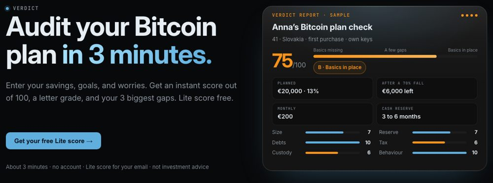
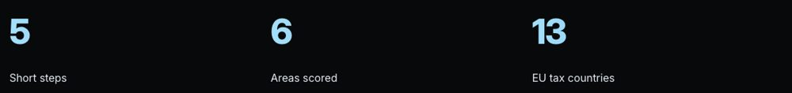
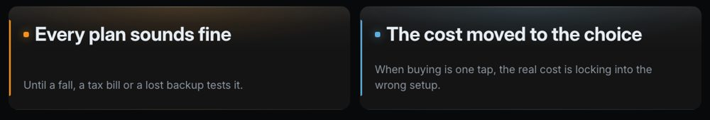
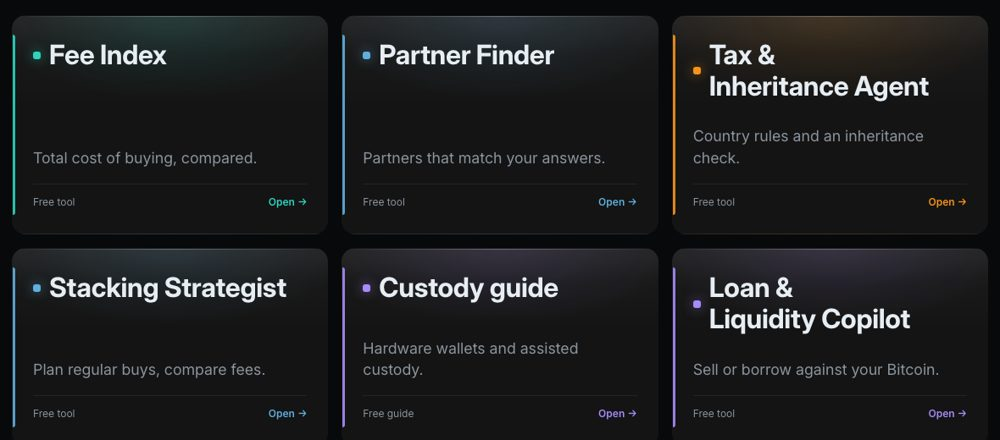
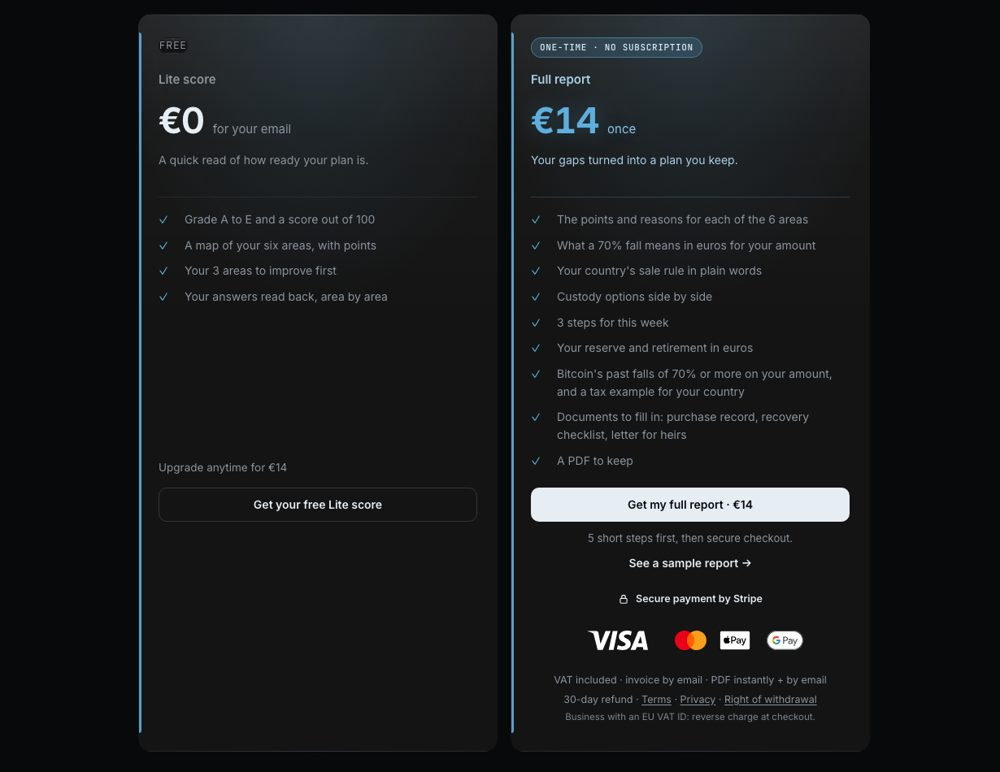
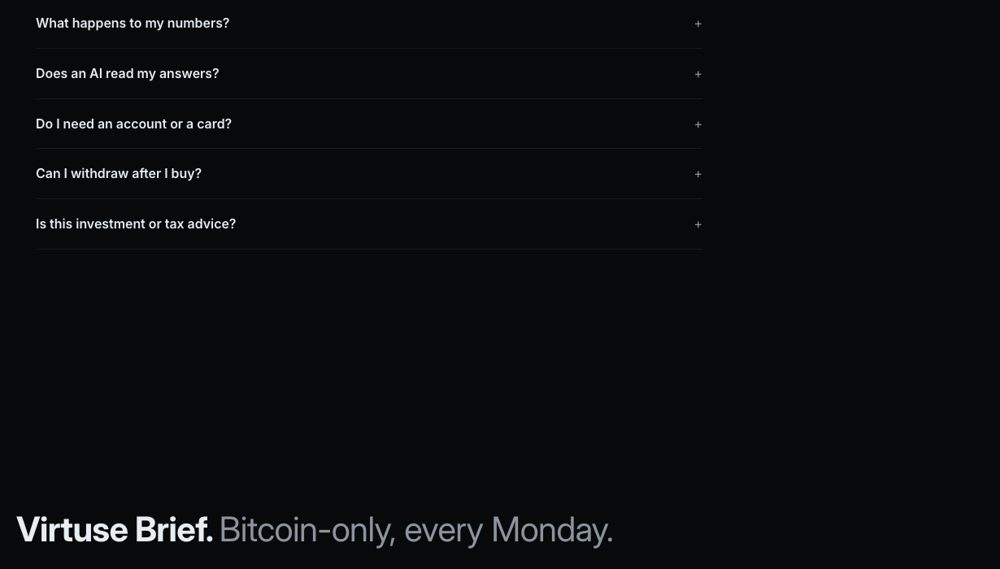

### Výber Lite alebo 14 € (obrazovka 7)

| # | Čo | Kde | Závažnosť | Návrh |
|---|---|---|---|---|
| F1 | Karta „Lite score“ sa natiahne na výšku karty za 14 €. Pole na e‑mail a tlačidlo „Show my Lite score“ sú tak úplne dole pod asi 250 px prázdneho miesta. Je to hlavná bezplatná akcia celého lievika. | `verdict-lite.css`, karty na `.ml-screen[data-s="7"]` (subgrid) | **vysoká** | Formulár hneď pod zoznam alebo karte nechať jej vlastnú výšku. Text a ceny sa nemenia. |

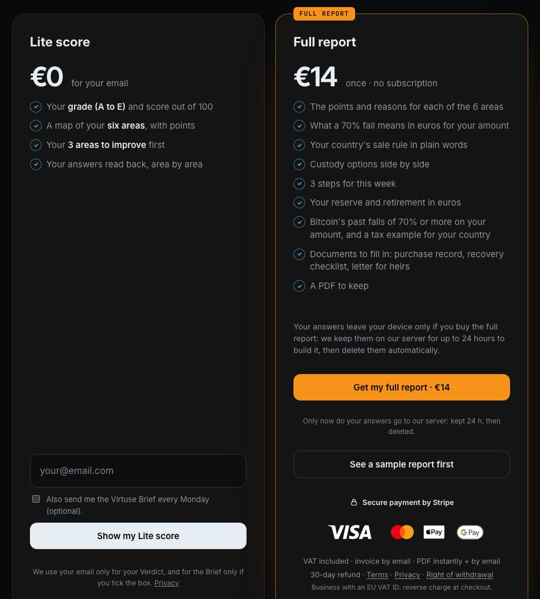

### Výsledok Lite (obrazovka 8)

| # | Čo | Kde | Závažnosť | Návrh |
|---|---|---|---|---|
| F2 | Známka „B“ je v zelenom štvorci, ale text „Basics in place“ pod ňou je oranžový. V ukážke na úvodnej stránke je B oranžové. Rovnaká známka má dve farby. | `verdict-lite.css`, odznak známky a štítok pásma | stredná | Jedna farba pre jednu známku na celej stránke aj v ukážke. |
| F3 | Tlačidlá „Book a free 15-min call“ a „Get my full report · €14“ sú tu celé zaoblené (999 px). To isté tlačidlo za 14 € je na obrazovke 7 obdĺžnik s rádiusom 8 px, inde na webe 10 px. | `verdict-lite.css`, tlačidlá v `.ml-paid` | stredná | Jeden rádius (10 px) pre všetky tlačidlá. |
| F4 | V zamknutom bloku je veta o ukladaní odpovedí dvakrát, inými slovami („Your answers leave your device only if…“ a pod tlačidlom „Only now do your answers go to our server…“). | obrazovka 8, blok `.ml-lock` | nízka | Nechať jednu. **Ide o text so súhlasom právnika, bez tvojho áno a bez právnika ho nemením.** |

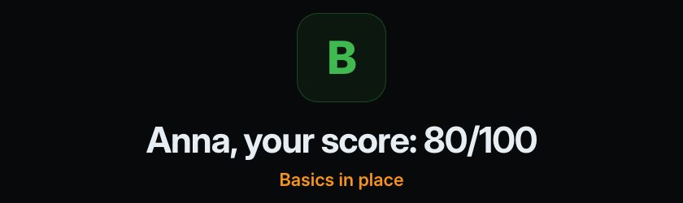
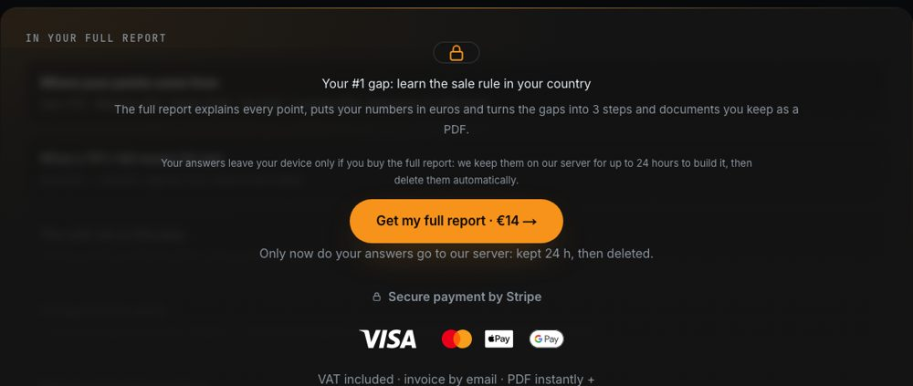
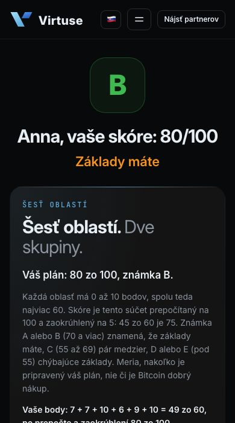

Ukážka plného reportu (obrazovka 9) je v poriadku: neutrálne plochy, jedna oranžová pre skóre, modrá pre mapu oblastí. Nič som tam nenašiel.

---

## 3. Brief `/news.html` a `/sk/news.html`

Brief má vlastnú redakčnú identitu (Plex Mono, Source Serif, veľké písmená v štítkoch sekcií, tenké linky). Tú neberiem ako chybu.

| # | Čo | Kde | Závažnosť | Návrh |
|---|---|---|---|---|
| N1 | Karty „Bitcoin price“ a „Bitcoin dominance“ ukazujú „n/a“, v EN aj SK. | `news/news.js`, dátové karty (CoinGecko) | stredná, **overiť** | Pravdepodobne CoinGecko blokuje headless prehliadač alebo staging (CORS). Overiť v bežnom Chrome na stagingu aj produkcii. Ak je to tak aj tam, je to chyba dát, nie dizajnu. |
| N2 | Veľmi malé písmo: 50 prvkov má 9,5 px, 55 má 10 px a 38 má 10,5 px (zdroje, časy, štítky v tickeri). Na mobile sa to číta ťažko. | `news/news.css` | stredná | Najmenšie písmo 11 px. |
| N3 | Nástroje v Briefe majú každý inú farbu rámčeka (oranžová, tyrkysová, modrá, fialová) a príklad dôchodkovej kalkulačky má hnedooranžové pozadie. Zvyšok Briefu je čisto oranžový. | `news/news.css`, `.tool-card` | nízka | Jedna farba (oranžová Briefu) a neutrálne pozadie príkladov. Je to schválený návrh v4, takže len ak chceš. |

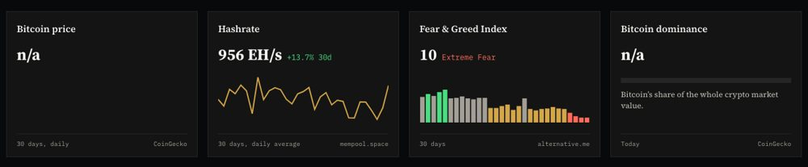
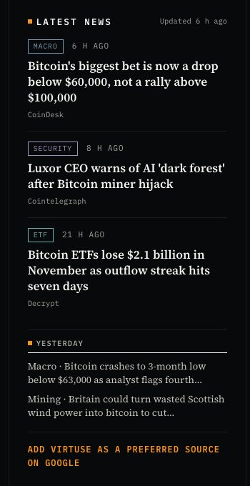
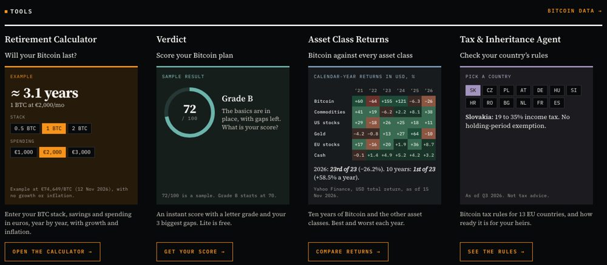
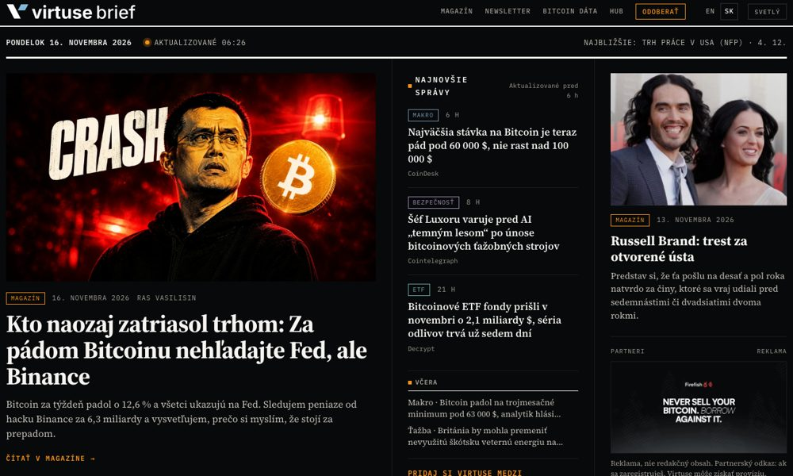

---

## 4. Dôchodková kalkulačka `/retirement-calculator.html`

| # | Čo | Kde | Závažnosť | Návrh |
|---|---|---|---|---|
| R1 | Hlavný nadpis má hrúbku 560, všetky ostatné nadpisy H1 a H2 v hube majú 700. Podnadpis má navyše oranžovo‑modrý prechod v texte. | `i18n-tools/retirement/build_retirement.py` (`.split-in .rc-q`), `site-v2.css` | stredná | Hrúbka ako všade inde a podnadpis plnou farbou (`--muted`). |
| R2 | Na stránke sú dva takmer rovnaké riadky „Want a personal verdict on your Bitcoin plan?“. Pri druhom riadku text hovorí o Partner Finder, ale tlačidlo znie „Start stacking“. | `build_retirement.py`, `.rc-verdict`, `.rc-cta` | stredná | Druhý riadok zrušiť. Pri Partner Finder dať tlačidlu názov cieľa. „Start stacking“ si ale vybral ty 13. 10., takže rozhoduješ ty. |
| R3 | „Copy link to this result“ je jediné sivé vyplnené tlačidlo na webe. | `retirement-calc.js` / `build_retirement.py` | nízka | Štýl sekundárneho tlačidla (obrys). |
| R4 | Štyri výsledkové boxy majú štyri farby (tyrkysová, modrá, žltá, fialová) aj farebné čísla. Ide o rovnaký druh údaja, farby nič neznamenajú. | `.rc-grid .rc-box.acc-*` | nízka | Neutrálne čísla, farba len pri tom, ktoré rozhoduje. Zmena z Batch C, takže voliteľná. |
| R5 | Pole „Bitcoin price today“ ukazuje záložnú cenu 74 649 € z 13. 10., kým text na tej istej stránke počíta s 58 646 € zo 16. 11. | `retirement-calc.js` (CoinGecko) | stredná, **overiť** | Rovnaká príčina ako N1. Overiť v bežnom prehliadači. |

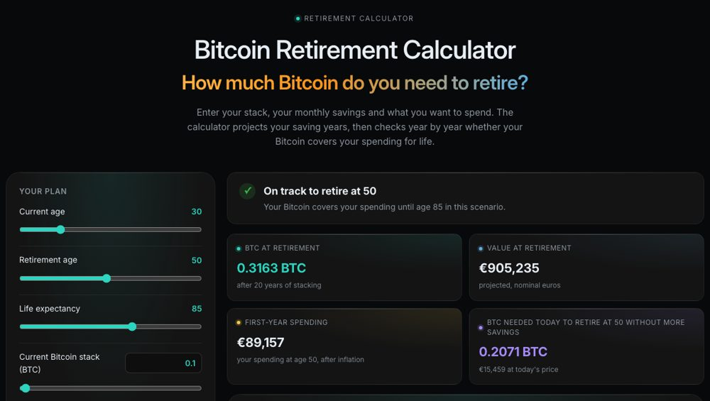
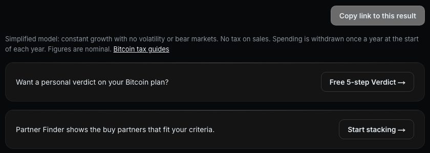
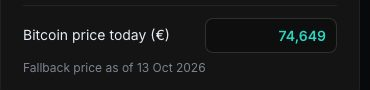

---

## 5. 200-týždňový priemer `/ma-200w.html`

| # | Čo | Kde | Závažnosť | Návrh |
|---|---|---|---|---|
| M1 | Stav „0.95× — Below the Floor — Historically Rare“ je sýtozelená plná pilulka, s veľkými písmenami v každom slove a pomlčkami. Inde na webe taká plocha nie je. | `i18n-tools/legacy/src/en/ma-200w.html` (stavový odznak) | stredná | Neutrálna plocha so zelenou bodkou, veľké písmeno len na začiatku vety, bez dlhých pomlčiek. Význam ostáva. |
| M2 | Štítok „How to read it“ je na sivom pruhu (starý `.sec-label`) a legenda sú pilulky s farebnými štvorčekmi. Pred nadpisom grafu je znak „◆“. To sú zvyšky starého dizajnu. | to isté, `.legend-section`, `.chart-title` | nízka | Štítok ako na ostatných stránkach, legenda ako jednoduchý riadok, bez „◆“. |
| M3 | Obsah má šírku 1104 px, blok Brief pod ním 1200 px. | `legacy` CSS oproti `site-v2.css` | nízka | Rovnaká šírka. |

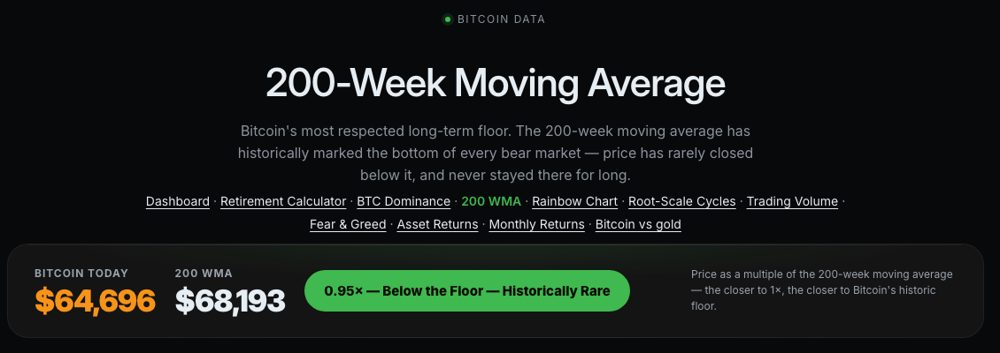
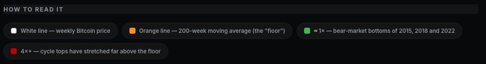

---

## 6. Daň z Bitcoinu, Slovensko `/bitcoin-tax/slovakia`

| # | Čo | Kde | Závažnosť | Návrh |
|---|---|---|---|---|
| T1 | V texte je pred slovom „Slovakia“ emoji vlajky 🇸🇰. Je to jediné emoji v obsahu webu (generuje sa na všetkých 13 krajinách v 10 jazykoch). | `seo-build/generate.mjs` (úvodná veta krajiny) | nízka | Emoji vynechať. |
| T2 | Upozornenie k DAC8 je tučný text bez rámčeka a odsadený inak ako ostatný text. | `seo-build/lib/html.mjs`, blok DAC8 | nízka | Rovnaký box ako zhrnutie hore alebo zarovnať s textom. |

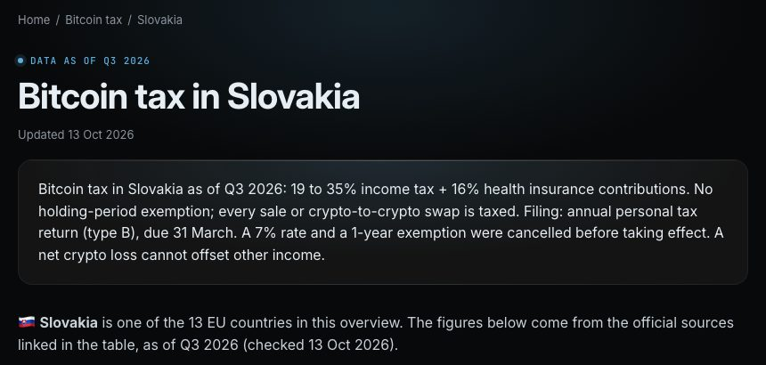
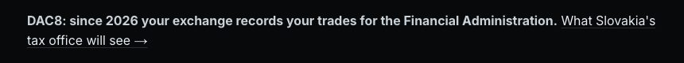

Inak je stránka čistá: jedna farba, tabuľka s tenkými linkami, žiadne efekty.

---

## Čo sa opakuje na viacerých stránkach

1. **Štítky nad nadpismi** majú najmenej šesť podôb: veľkosť 9 až 14 px, rozostupy písmen od 0,66 do 1,68 px, bodka s krúžkom alebo bez neho, farba sa mení podľa sekcie. Návrh: jeden token (12 px, jeden rozostup, jedna farba na stránke).
2. **Tlačidlá** majú rádius 7, 8, 10 aj 999 px a hlavné tlačidlo je raz svetlé, raz oranžové, raz modré, raz sivé. Návrh: rádius 10 px, hlavné svetlé, oranžové iba ako jediné „razítko“ na obrazovke (pravidlo z 5. 11.), sekundárne obrysové.
3. **Prechod v texte** mimo jednej schválenej frázy v nadpise homepage: čísla na Verdicte, podnadpis kalkulačky. Pätičkové logo Virtuse nechávam.
4. **Farebné žiary** na číslach a tieňoch: €480, €14, Verdict ukážka, krúžky okolo bodiek v štítkoch.
5. **Medzery mimo 4 px mriežky:** 13, 9, 5, 17, 12,5 a 11,25 px, najmä v `site-v2.css` a `verdict-landing.css`.
6. **Hrúbka nadpisov:** H1 700 všade okrem kalkulačky a 200 WMA (560). Veľkostí H3 je veľa (13, 15, 17, 19, 20, 24, 26, 28, 32 px).
7. **Šírky obsahu** na jednej stránke: 1104, 1152, 1200, 900 a 820 px. Skok je vidieť hlavne pri bloku Brief.
8. **Pätičky** sa medzi stránkami líšia (Ecosystem, Virtuse CFO).
9. **Písmo menšie ako 11 px:** Brief (9,5 až 10,5 px) a Verdict ukážka na homepage (popisky 9 px veľkými písmenami).

---

## Na toto nesiahať (je to identita Virtuse a funguje to)

- Logo V, modrá pätičková značka „Virtuse“ s prechodom a jej pomalá animácia.
- Neutrálna grafitová paleta (`#08090a`, `#141414`), tenké linky, Inter a JetBrains Mono.
- Kocka v hero homepage (je aj na OG obrázku).
- Kategóriové farby `acc-*` (Store tyrkysová, Borrow fialová…) ako malá bodka a jemná žiara v rohu. Schválil si ich v Batch A až C.
- Nadpisy „tučná časť + sivé pokračovanie“ na celom webe.
- „How it works“ ako časová os s jednou oranžovou bodkou.
- Obrázky Obr. 0.1 až 0.3 ako koncept.
- Ticker partnerov, mapa oblastí vo Verdicte (radar), ukážka reportu Anny.
- Brief: redakčný vzhľad podľa schváleného návrhu v3 (Plex Mono, Source Serif, štítky veľkými písmenami, linky, jedna oranžová).
- Platobné značky, riadok o prevádzkovateľovi, všetky právne texty, ceny, poradie odporúčaní.

---

## Koľko súborov by zasiahla oprava

- **Ručne upravené zdroje:** asi 8 až 10 súborov: `index.html`, `site-v2.css`, `verdict-landing.css`, `verdict-lite.css`, `news/news.css`, `i18n-tools/retirement/build_retirement.py`, `i18n-tools/legacy/src/*/ma-200w.html`, `seo-build/generate.mjs` a `seo-build/lib/html.mjs`, pri H7 `i18n-tools/home/sk.json`.
- **Pregenerované stránky:** 9 jazykových homepage (cez `build_lang.py`), 4 stránky Verdictu, 2 stránky Briefu, 10 kalkulačiek, 10 stránok 200 WMA a asi 210 SEO stránok, ak sa zmení T1 alebo T2.
- **Pozor na cache:** akákoľvek zmena `site-v2.css` znamená zvýšiť `SITE_CSS_V` a skript `site_v2_version.py` ho prepíše na asi 670 stránkach (súbory s `?v=` sa ukladajú v cache na rok). Rovnako `?v=` pri `verdict-lite.css` a `news.css`. Ak opravy v `site-v2.css` vynecháme a dáme ich do súborov jednotlivých stránok, zostane to pri zhruba 40 súboroch.

---

## Voliteľné väčšie nápady (menia identitu, nie sú to opravy)

Toto by unslop navrhol, keby smer vyberal sám. Nič z toho nepovažujem za chybu.

1. **Nadpisy v hrúbke 500 namiesto 700**, hierarchiu by niesla veľkosť a farba. Web by pôsobil pokojnejšie, ale menej ako teraz.
2. **Štítky nad nadpismi bez veľkých písmen** („Six areas“ namiesto SIX AREAS). V hube áno, v Briefe nie, tam je to súčasť redakčného vzhľadu.
3. **Bez prechodu v nadpise homepage** („compared.“ plnou oranžovou).
4. **Jedna farba namiesto kategóriových farieb** a kategórie len ako sivé bodky. Hub by bol tichší, ale stratil by orientáciu podľa farieb.
5. **Hero homepage s náhľadom produktu** (tabuľka poplatkov, ktorá dnes sedí pod hero) namiesto kocky. Unslop uprednostňuje „ukáž produkt“, kocka je ale tvoja značka.
6. **Krátke video „unslop story“** z jednej obrazovky na X (skill to vie cez Playwright a ffmpeg, ffmpeg na tomto Macu chýba).

---

## Čo som nepreveril

- Plugin unslop nie je nainštalovaný (chýba `claude` v PATH). Pravidlá som použil ručne z repozitára.
- Animácie som posudzoval z vypočítaných štýlov a statických snímok, nie zo živého videa.
- Svetlú tému Briefu som nepozeral, len tmavú, ktorá sa načíta predvolene.
- N1 a R5 (n/a a záložná cena) môžu byť len vlastnosť headless prehliadača. Treba overiť v bežnom Chrome.
- Mobil (390 px) som prezrel vizuálne na homepage, Briefe, kalkulačke, 200 WMA a výsledku Verdictu. Na ostatných stránkach som kontroloval len pretečenie (0 px).
- Lighthouse a CLS v tejto fáze nebežali. Podľa zadania prídu až vo fáze 2 s pred a po snímkami.

Audit podľa pravidiel unslop od Damira Sokolovského (@heydamir), CC BY 4.0.
